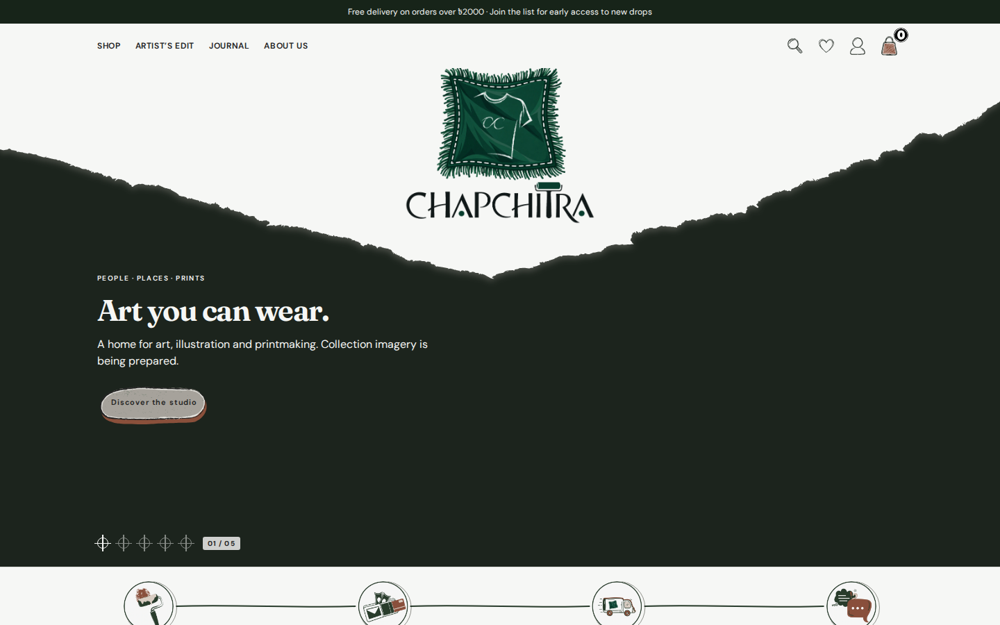
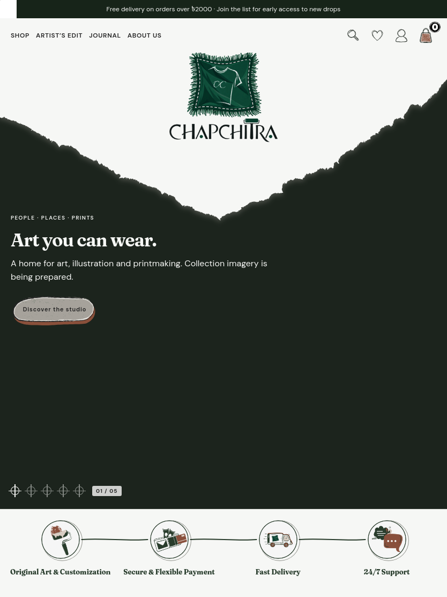
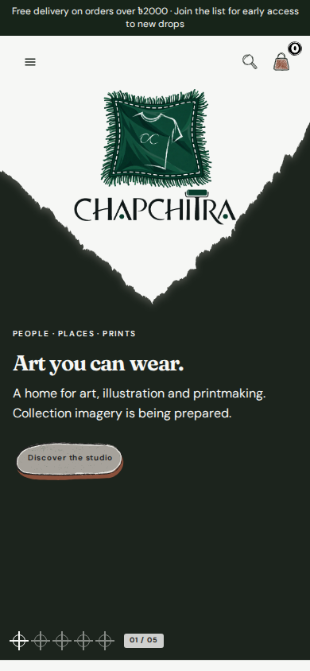
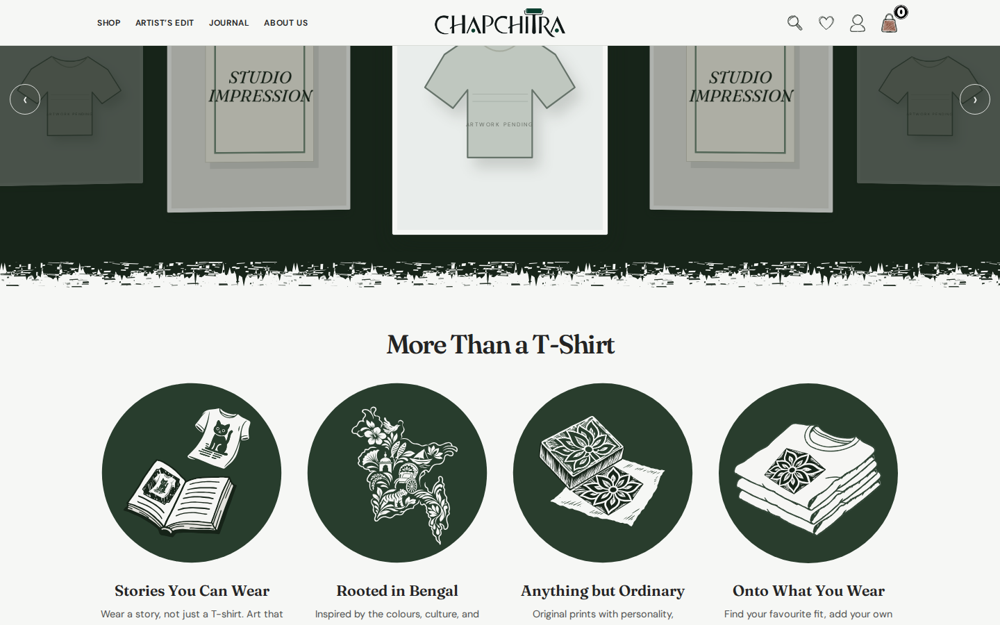
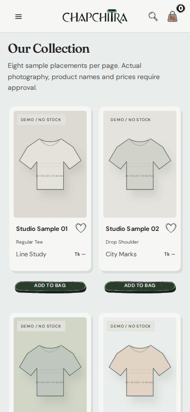
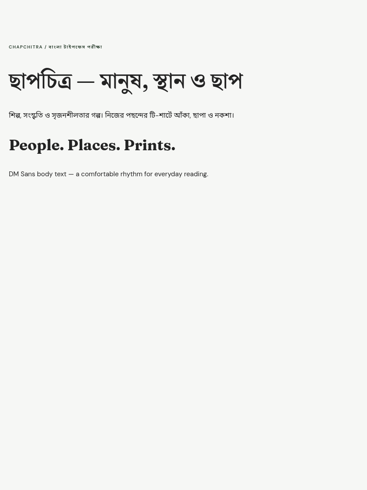

# CHAPCHITRA — Fraunces + DM Sans | Final Typography Creative Review

**Review-only, no merge or deploy.** This is a typography-only child branch of the approved Hero 01 scrolling PR #120, baseline 11e2bcd4c41429b8f753305dfffbd5a799200466.

## Type roles

- **Fraunces variable:** English editorial headings; semibold 650 on Hero headlines, 550 on section/page headings, regular/light italic on artistic phrases.
- **DM Sans variable:** English body at ~16px, navigation, buttons, product card titles, product-detail heading/price, form fields, Shop filters, cart, and live Artist’s Edit controls.
- **Bengali:** Noto Serif Bengali variable for Bengali headings and Noto Sans Bengali variable for Bengali interface/body text; tested with actual Bengali copy.
- **Delivery:** Eight locally hosted variable WOFF2 Latin/Latin-Extended and Bengali subsets, ~634 KB in total. Two critical Latin preloads only; all other subsets load on demand. Original OFL license texts included.
- **Protected:** C08/logo artwork, approved V scroll choreography, four-second/eight-second hero clock, C01/C02/C03/C05 motion, artwork, colors and Artist’s Edit logic remain untouched.

## Actual browser screenshot gallery

| Page / type check | Desktop Chromium | iPad WebKit | Mobile Chromium |
|---|---|---|---|
| Hero 01: Art you can wear. | [Desktop](desktop-chromium-home-hero.png) | [Ipad](ipad-webkit-home-hero.png) | [Mobile](mobile-chromium-home-hero.png) |
| More Than a T-Shirt | [Desktop](desktop-chromium-values-more-than-a-tshirt.png) | [Ipad](ipad-webkit-values-more-than-a-tshirt.png) | [Mobile](mobile-chromium-values-more-than-a-tshirt.png) |
| Home product cards | [Desktop](desktop-chromium-home-products.png) | [Ipad](ipad-webkit-home-products.png) | [Mobile](mobile-chromium-home-products.png) |
| Shop & filters | [Desktop](desktop-chromium-shop.png) | [Ipad](ipad-webkit-shop.png) | [Mobile](mobile-chromium-shop.png) |
| Product detail & price | [Desktop](desktop-chromium-product-detail.png) | [Ipad](ipad-webkit-product-detail.png) | [Mobile](mobile-chromium-product-detail.png) |
| Favorites | [Desktop](desktop-chromium-favorites.png) | [Ipad](ipad-webkit-favorites.png) | [Mobile](mobile-chromium-favorites.png) |
| Cart / Demo Bag | [Desktop](desktop-chromium-cart.png) | [Ipad](ipad-webkit-cart.png) | [Mobile](mobile-chromium-cart.png) |
| Journal | [Desktop](desktop-chromium-journal.png) | [Ipad](ipad-webkit-journal.png) | [Mobile](mobile-chromium-journal.png) |
| About Us | [Desktop](desktop-chromium-about.png) | [Ipad](ipad-webkit-about.png) | [Mobile](mobile-chromium-about.png) |
| Artist's Edit | [Desktop](desktop-chromium-artists-edit.png) | [Ipad](ipad-webkit-artists-edit.png) | [Mobile](mobile-chromium-artists-edit.png) |
| Bengali script shaping | [Desktop](desktop-chromium-bengali.png) | [iPad WebKit](ipad-webkit-bengali.png) | [Mobile](mobile-chromium-bengali.png) |

### Featured visual checkpoints

| Desktop Hero | iPad Hero | Mobile Hero |
|---|---|---|
|  |  |  |

| More Than a T-Shirt | Product cards | Bengali text |
|---|---|---|
|  |  |  |

## QA evidence

- **269/269 native tests:** PASS, Node 22.
- **Production-equivalent build:** PASS; the build injects only 2 Latin preloads into 17 website entrypoints.
- **Desktop / iPad-width WebKit / mobile browser QA:** 33 images, 10 live pages each, plus one Bengali QA page per viewport. PASS in all profiles; zero measured horizontal overflows or page exceptions.
- **Product names:** 600-weight DM Sans; Product Detail heading/price corrected to DM Sans, including on mobile.
- **Bengali font checks:** the exact Noto Serif Bengali and Noto Sans Bengali families report loaded on all 3 browsers, and glyph shaping was visually reviewed.
- **Font downloads:** same-origin WOFF2; no network requests to Google Fonts at runtime. Home/Shop measured CLS 0 in desktop Chromium, mobile Chromium and iPad WebKit.
- **Artist’s Edit CLS:** the preexisting asynchronous worktable mount causes intermittent layout shifts independent of fonts. Baseline PR #120 measured CLS 0.393 desktop / 0.600 mobile; typography candidate 0.388 desktop / 0.028 mobile in comparison. Do not change this approved cross-lane behavior under a font-only task.

Evidence details: [Per-page browser and computed-style audit](browser-audit.json), [font-loading, preloads and layout shift](font-loading-qa.json), [baseline-vs-candidate CLS source comparison](cls-baseline-comparison.json).

## Independent adversarial creative critic

See [Creative critic review](CRITIC_REVIEW.md). Verdict: **visual/technical typography consistency passes; owner creative acceptance is still pending**.

## Outstanding review boundaries

- WebKit at iPad width is Playwright emulation; no physical iPad Safari recording has been made.
- The existing Artist’s Edit initial-mount CLS is tracked as a separate workstream; it is not caused by the new typefaces.
- No protected branch updates or Render deployments. This is a stacked review PR based on PR #120, which remains draft; do not merge or deploy without owner authorization.
