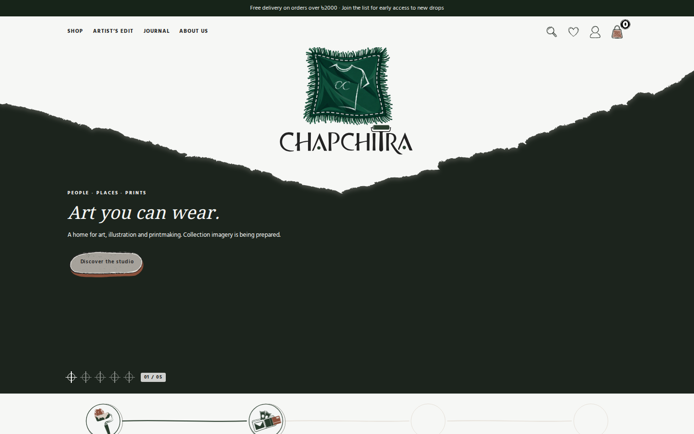
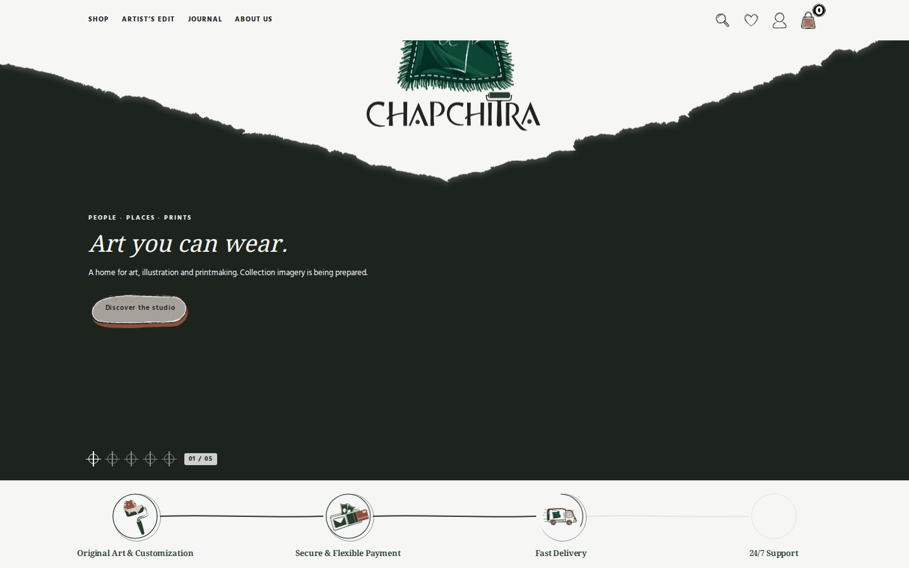
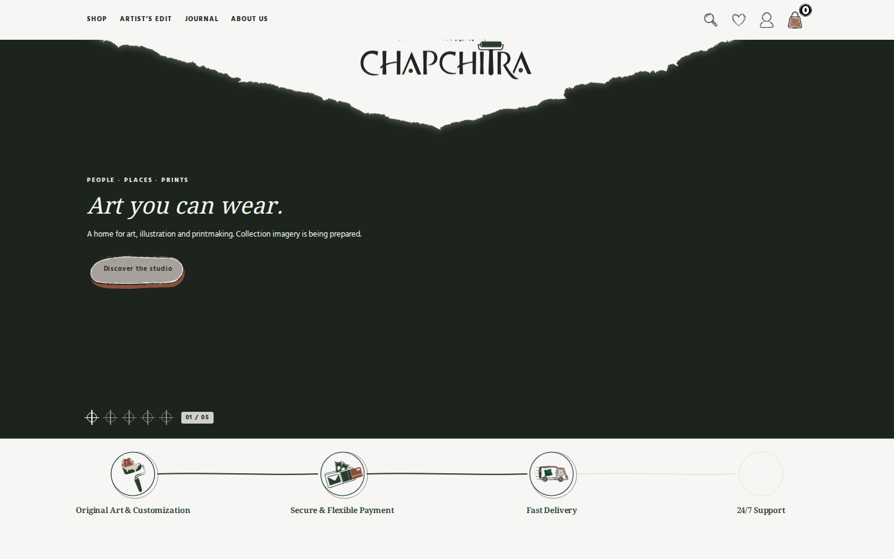
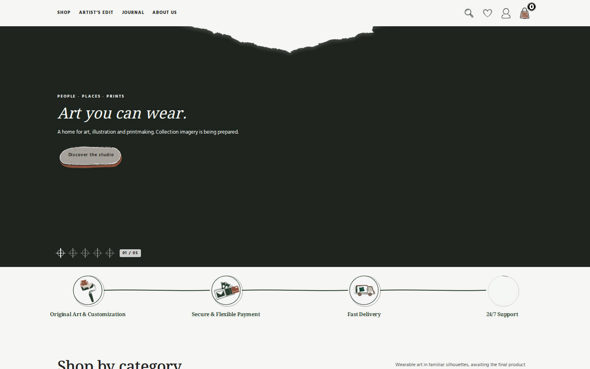
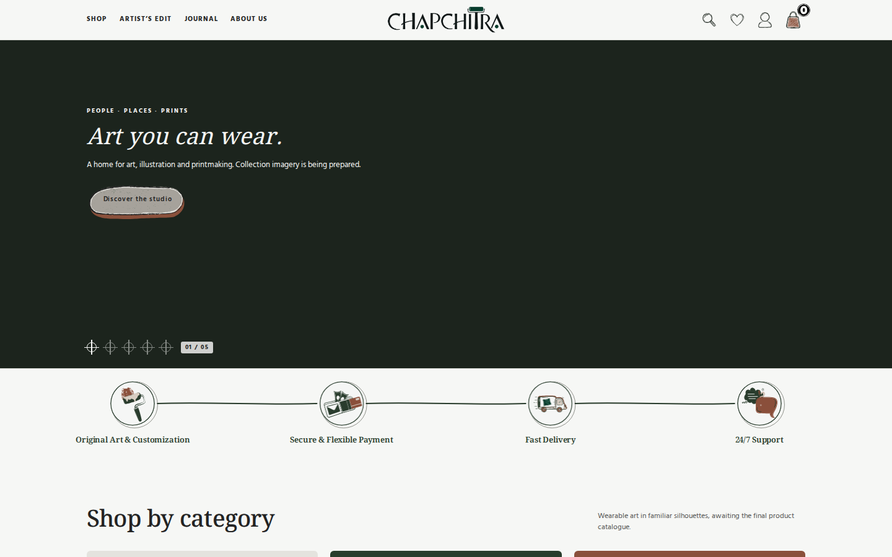
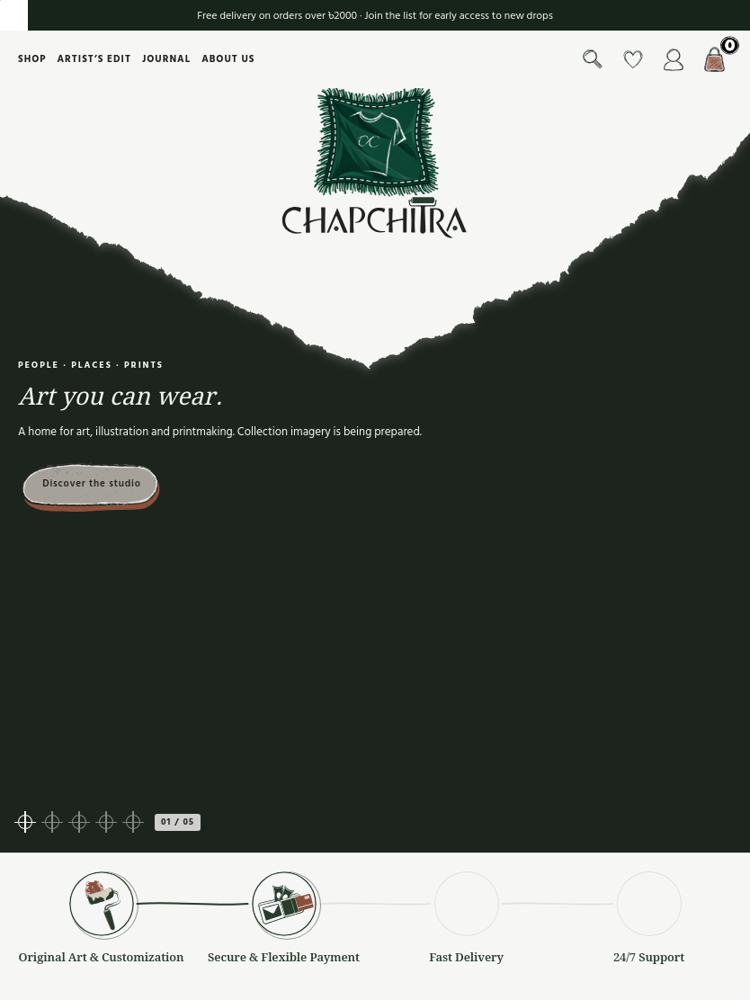
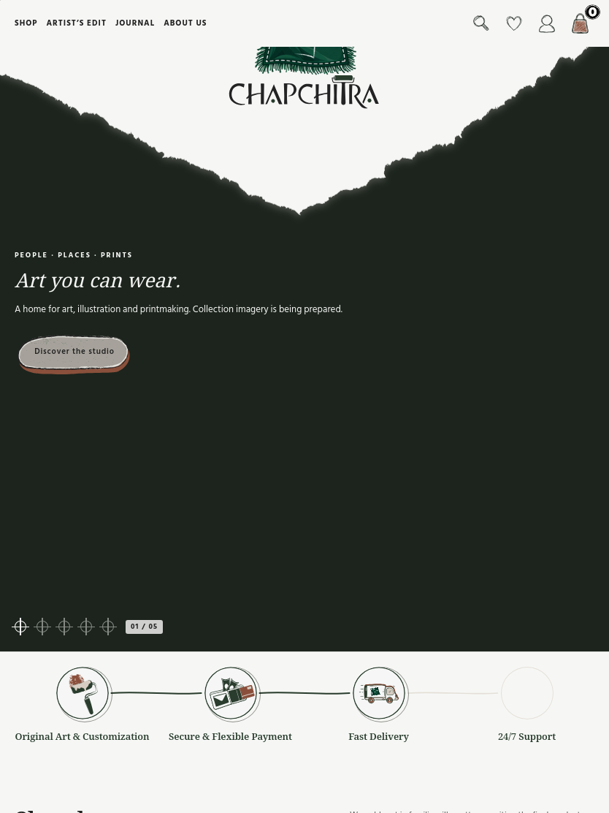
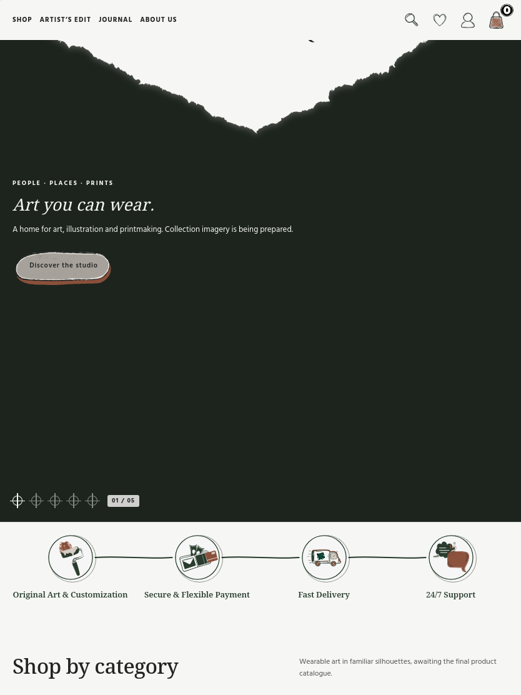
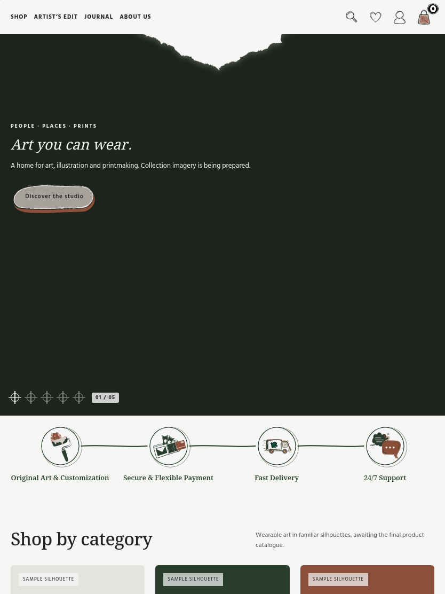
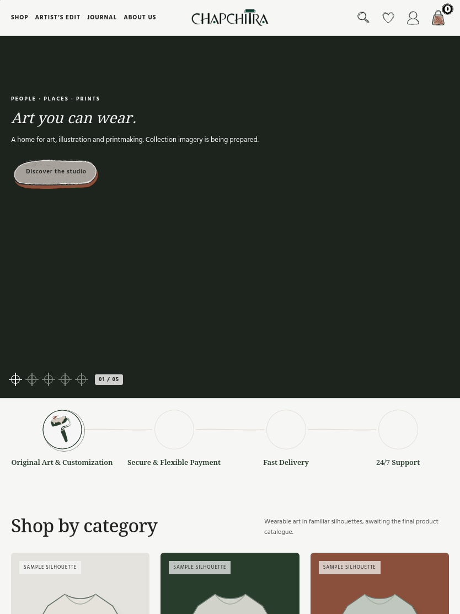

# CHAPCHITRA Hero 01 — Scroll-Driven V Retraction

**Review-only evidence. NOT approved, merged, or deployed.**

Baseline: `deploy/chapchitra-render-review` at `ad42d075e9e99d268202646ab7396ddd077053ee`. All changes are contained inside `projects/chapchitra/`.

## What changed

- Both the approved original single SVG paper and C08 illustrated logo share **one scroll-controlled transform**, computed from current sticky-header bottom and true scroll position.
- The complete V retracts behind the sticky Gallery White header. The 12px clearance hides the existing drop-shadow before compact wordmark activation.
- Upward scrolling reverses every position geometrically. No opacity fade, keyframed transition, independently timed animation, extra paper path, or logo redesign.
- SVG viewBox clipping prevents the large Illustrator master path painting outside its original viewport. Original path data and the 90% logo scale remain unchanged.
- Hero 01 8s and Heroes 02–05 4s carousel intervals remain untouched.

## Desktop Chromium · 1440 × 900

[**Continuous slow downward/upward recording**](desktop-chromium-continuous-down-up.webm)

| 0% | 25% | 50% | 75% | 100% |
|---|---|---|---|---|
|  |  |  |  |  |

Reverse captures: [75%](desktop-chromium-up-075.png) · [50%](desktop-chromium-up-050.png) · [25%](desktop-chromium-up-025.png) · [0%](desktop-chromium-up-000.png).

## iPad-sized WebKit · 834 × 1112

[**Continuous slow downward/upward recording**](ipad-webkit-continuous-down-up.webm)

| 0% | 25% | 50% | 75% | 100% |
|---|---|---|---|---|
|  |  |  |  |  |

Reverse captures: [75%](ipad-webkit-up-075.png) · [50%](ipad-webkit-up-050.png) · [25%](ipad-webkit-up-025.png) · [0%](ipad-webkit-up-000.png).

**Device caveat:** Playwright WebKit at iPad viewport size, not a physical iPad recording.

## Technical evidence

- Native full suite: **265/265 tests passed** (Node 22).
- Isolated static build: **passed**.
- Dedicated continuous scroll QA: **both profiles passed**; 9 screenshots and one video each.
- Browser asserts check header-relative continuous edge geometry, no fade or CSS easing, original path retained, exact reversed positions, no duplicate logo, full 100% clearance, C08 completion, no missing assets or JavaScript exceptions.
- [Detailed machine-readable measurements](retraction-qa.json).

**Creative review still pending. Do not fast-forward staging, merge the PR, or deploy.**
