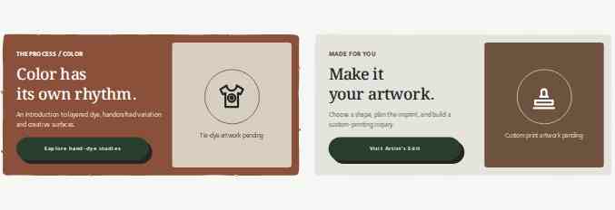
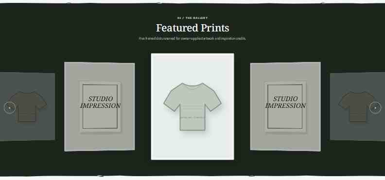
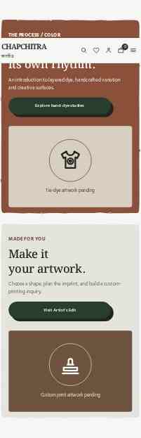

# CHAPCHITRA — layout and provisional printed-edge review

These are **real Chromium browser captures** from the **READY immutable preview** [`43aecf3`](https://chapchitra-motion-demo-7in41peum-samvrc.vercel.app/). Screenshots are 1440px desktop and 390px mobile browser contexts, downsampled for review.

**Important:** The SVG dry-brush pattern is **not approved/final**. The owner has stated that a further **authoritative texture-density reference is forthcoming**. The live preview demonstrates the structural placement and responsive section layout; the final edge texture is intentionally deferred.

## Desktop — Editorial Banners

## Desktop — Full-bleed Featured Prints

## Mobile — Editorial Banners

## Mobile — Featured Prints

## QA and constraints

- `npm run build`: 31/31 checks passed at deployed source and the later review refinement.
- Actual Chromium regression: 40/40 responsive checks at 1440, 820 (iPad-like), 390 and 320 pixels: the sticky header's layout viewport top measured 0px after scroll; full-bleed stage `x=0` and width=viewport; carousel active frame and arrows remain interactive; 5 frames remain in the DOM; colors and Gallery White benefits match approved tokens; no overflow/JS errors.
- **Not a physical iPad Safari test.** Playwright WebKit could not be launched because required libraries were unavailable in the Linux sandbox. Owner must confirm on physical iPad Safari before marking the sticky-chrome gap resolved.
- The updated **READY** branch deployment includes two small refinements made after these screenshots: the Featured subtitle is hidden and mobile arrow borders use dark ink for stronger contrast.
- Vercel's manual API deployment endpoint returned a **100 deploys/day** limit, but the connected Git deployment succeeded independently. The review source and screenshots are available in the updated preview.
- Preserve CHAPCHITRA isolation; do not change the approved button, Polaroid, cart or unrelated animations without owner authorization.
