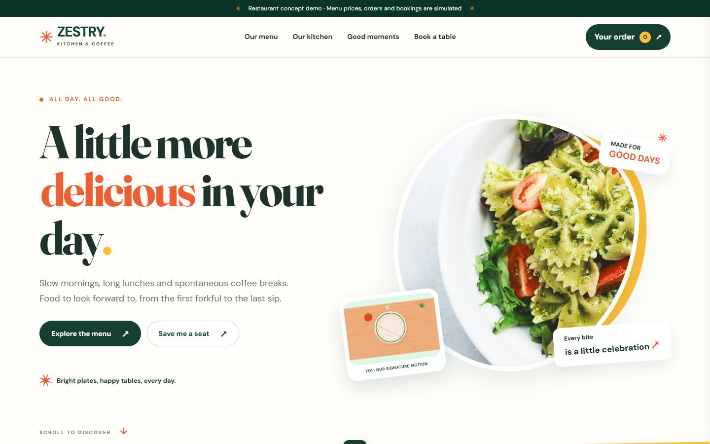
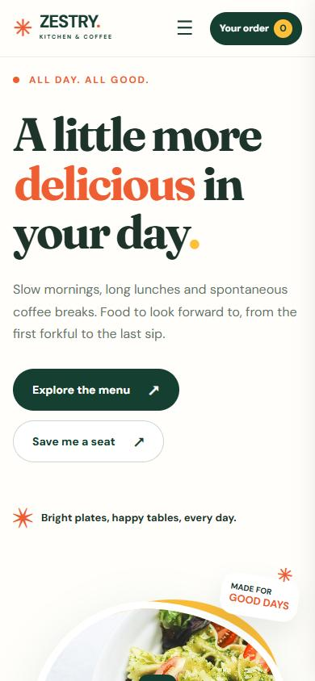

# ZESTRY — Independent Browser & Creative QA

**Branch:** `feat/restaurant-lottie-bistro-demo-20261116`  
**Scope:** Only `projects/restaurant-demo/`  
**Host:** Windows development machine, localhost static Node server  
**Status:** Functional frontend prototype; outstanding Lottie integrations prevent final motion approval.

## Verified automated browser checks

1. Nine practical menu dishes render.
2. All real food photographs load successfully.
3. F01, F02 and F06-1 original vector Lotties render in a browser.
4. Mains filter returns three dishes.
5. Add to cart increments quantities.
6. Cart contents match selected dish.
7. F04 original order-confirmation Lottie plays.
8. Simulated checkout confirms without accepting payment.
9. Simulated table reservation confirms without creating a booking.
10. Interactive menu preview modal opens.
11. Mobile viewport (390px) has no horizontal overflow.
12. Mobile navigation toggles and closes on selection.
13. No JavaScript page exceptions.
14. Browser captured desktop and mobile visual checkpoints.

## Visual checkpoints

## Independent creative review notes

- Clean serif display typography and photographic hero create a restaurant presentation, not an animation gallery.
- Restaurant menu, checkout, reservations, chef and coffee sections form realistic customer journeys.
- Bright forest, orange, yellow, blue and mint aesthetic is aligned with the approved Food Pack direction.
- Animation assets remain isolated from commerce logic. If an animation is missing, the customer journey must still function.
- The hero Lottie appears as a branded accent beside genuine food photography; evaluate prominence with the owner before final creative signoff.

## Pending acceptance gates

- Missing original F03 Coffee, F06-2 Mixing, F06-3 Simmering, F07 Reservation and unproduced F08.
- F05 review HTML is a self-contained interactive QA player, **not** proof of official dotLottie runtime compatibility; owner-final artwork still requires review.
- Cross-browser SVG/Lottie playback profiling and animation file-size optimization after all original exports arrive.
- No real address, opening hours, reviews, payment, booking, or live data integrations are claimed.
- No production deployment or merge has been authorized.

**QA verdict:** Functional prototype and imported animation subset verified. **Full pack integration and creative approval remain pending.**
